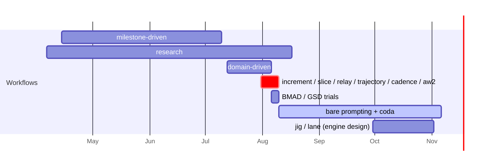
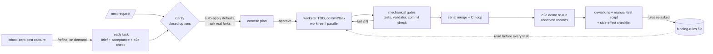

# Workflow assessment: Mar–Nov 2026

This assessment covers about 8.8k user prompts across 73 projects (`~/backups/claude-code`, 2.1 GB). Eight parallel analysts each took one slice: the domain-driven era, trajectory, relay/cadence/increment/aw2, research and authoring, recent ad-hoc projects, bare/BMAD/GSD baselines, cross-project prompt history, and the evolution of the skills repo. Its purpose is to feed the design of a new workflow.

## TL;DR

- **Process shipped less than no process.** On spaceport, Jul 28–Aug 8 consumed 94 sessions and about 730M tokens (45% of all spend) and left **zero surviving lines**. From Aug 13, bare prompting with a fixed prompt coda landed 70k of 78k lines in 4 days. Bare synaptic is in production; the own-workflow synaptic run was abandoned after 2 days. BMAD and GSD produced docs and no product.
- **The failure was never code quality. It was ceremony and gates.** Interviews and decisions were mostly rubber-stamped: 74–78% of answers took the recommended option. Strategic modelling had no exit to building. Strict harnesses stalled trivial tasks.
- **The user has already converged on a workflow, but types it by hand.** The loop is: assess → clarify questions → brief plan → approve → one subagent per task, TDD, commit per task → deviations summary. It was pasted 20× in marquee, about 19× in readiness, and about 10× in spaceport.
- **The ideas that survived every rewrite are mechanical:** a script for state and queries, derived status, a single writer for the backlog, an inbox → refine → burn spine, worktrees with a serial merge, and verifying claims against artifacts.
- **Restarting was the biggest hidden cost.** About 7 frameworks were built and tried in 10 days (Jul 31–Aug 10). That left 16 abandoned `spaceport*` directories (about 488 discarded commits), and lessons were re-derived each time instead of carried over.

## Timeline

Workflow-skill invocations per month: Jun 274, **Jul 695**, Aug 395, **Sep 19, Oct 19**. Milestone-driven was the only workflow that lasted (about 3 months). Domain-driven lasted about 3 weeks. Everything after it lasted 1–4 days each.

## Results by approach

| Approach | What happened | Verdict |
|---|---|---|
| milestone-driven | Long-lived; its loop survives as the hand-typed marquee template | ✅ core loop right, ceremony dropped |
| domain-driven (spaceport, synaptic) | Strong grounding and propagation. But: 36 + 22 ADRs, exemplars up to 998 lines, **0 tasks, 0 code** in 2 attempts | ❌ no exit to building |
| trajectory v1 | High-quality decisions and tasks; burns reliable (0 merge bounces, about 5 grader rejections in 41 tasks). But 13 decisions for "cargo workspace + `version`", about 69k words of prose for 9k LOC, a fabricated closing record, and `serve` "done" without serving | ⚠️ burn good, upfront gating too heavy |
| trajectory v2 (inbox / refine / burn / harvest) | About 23 tasks merged in one day, 3–5× faster than v1; then sandbox walls | ✅ promising shape, killed by harness friction |
| relay | "None of the runs finished successfully"; touches-fence and grader chain stalled simple tasks | ❌ over-gated |
| cadence (Rust CLI) | 14 of 63 self-hosted tasks, then abandoned; 793M tokens | ❌ engine before product |
| aw2 spine / increment | 21 subagents per increment, every verify FLAGGED, 473k output tokens in the main session | ❌ verification overspend |
| research → synaptic-authoring | 266 AUDITs nobody resolved; 266 topics / 513 unlinked terms; abandoned | ❌ too many layers |
| track-* (repo-local, 8 short skills) | 93 topics / 267 questions in about a day; validate clean | ✅ thin skills, tool as authority |
| lineup gather-data-cycle | 18/18 candidates, HALT on schema gaps, one commit each | ✅ |
| readiness `/build-check` | 10 implementer tasks → reviewer (3 rounds) → docs gate; 4.5h unattended, 0 corrections | ✅ best observed structure |
| bare + coda (spaceport, synaptic, marquee) | Shipped the products | ✅, but rules forgotten, decisions relitigated, user acts as the integration test |
| BMAD | About 12h of planning, stalled in Epic-1 foundation; the 3-lens code review was the valuable part | ❌, adopt the review |
| GSD | Abandoned after the research step | ❌ |

## What works

1. **Assess → ask → plan → approve → build loop.** It is the user's natural rhythm. Answers come back as "1a 2b" and then "go".
2. **"Fix what doesn't need my judgement, surface the rest."** The single most effective instruction. It shows up in 4+ projects.
3. **One subagent per task to keep the main thread lean.** In marquee the main thread used 1–6M input tokens against 7–205M in subagents.
4. **Fan-out read-only auditors and critics.** Security auditors (spaceport `cfb52215`), fresh-context spec critiques (about 20 SCRATCHPAD sessions for 0.5M tokens), and the BMAD blind / edge-case / acceptance lenses.
5. **Bounded review loops.** `/build-check` runs reviewer → fix tasks → at most 3 rounds → human gate.
6. **The fan-out law.** One worker owns one file. The orchestrator mints ids, shared counters and wiring serially. Letting workers write their own files cut orchestrator output from 1.78M to 0.74M.
7. **Work order as a file.** A per-unit brief in frontmatter lets context-free workers write the unit correctly, and the session can resume after `/compact`.
8. **Deterministic validators and scripts as gates.** `synaptic validate`, `check-dag`, `verify-batch.sh`. Every invariant that held was held by a script; prose bans failed (the `0001a` suffix came back 3×).
9. **Re-verification at landing.** `/land` re-ran the harness ("values reproduce byte-for-byte") and caught a false READY.
10. **Human-approved source list before writing.** Scouts propose sources, the human accepts, then one digest per source. This removed the CONFIDENCE churn and the WebSearch exhaustion.
11. **DAG-layer scheduling instead of fixed batches.** 92 topics in 25 minutes; fixed batches of 4 spent most of their time waiting on stragglers.

## What doesn't work

| Theme | Evidence |
|---|---|
| **Spec with no exit to code** | DDD: about 2.5 days and about 200M cache_read, zero code. "near endless sessions of specification dialog before writing the first line of code" |
| **Rubber-stamp interviews** | spec-sharpener: 74% bare "1/a/yes"; trajectory: 78% took Recommended; 2h sessions spent confirming defaults |
| **Over-asking** | "It should just do its job not ask me whether I want to do what I just commanded"; "`/build` … Default to the next item" |
| **Over-gating / harness blocks completion** | relay: "twice as fast writing this myself… harness so tight that it prohibits finishing the job"; touches-fence "broken by design" |
| **Decisions spawn decisions** | 13 decisions for milestone 1; "the new decision item that fell out of this one", then an interrupt and the end of v1 |
| **Planning mistaken for progress** | "Is that fixed now?" → "No. Nothing is fixed — no code has changed" |
| **All tasks done, outcome missing** | `serve` "a config validator wearing the name of a server" |
| **Fabrication** | Closing record invented a Linux-host run and the grader accepted it. Also: invented CLI flags ("`--origin` was never in the original documents"), invented an author name/email, invented inbox ids |
| **Sandbox / auto-mode / worktrees** | Problems from May to Oct: heredoc approvals, bind 127.0.0.1 blocked, `.claude/agents` deny-list, `.git/config` locks, "Create Unsafe Agents", manual ff-merge. "Aaand we're back at sandbox issues…" |
| **Token cost** | author-ingest 600k+; polish main session 6.36M output; aw2 622M; marquee M5 93M (one agent re-reading 331k per turn) |
| **Audits produce backlogs, not decisions** | 266 AUDITs and 57% of CONFIDENCE markers merely converted |
| **Artifact sprawl and drift** | ADR + exemplar + dossier + domain-model + context-map + summaries; skill-hopping in one session; repeated "resolve the contradictions" requests |
| **Fragile workflow scripts** | `implementation-cycle-run` went 0/2: auto-selected by the model, string arg silently ignored, agent type not installed |
| **Bare-mode gaps** | Cross-cutting rules forgotten ("every command goes through the operator socket", restated 3×); identity model relitigated 4×; non-atomic commits (p90 2468 lines); manual CI-red loops (6 pasted URLs, about 32M tokens) |
| **Unstable design advice** | 49 identical re-submits. "4 times… 2 times you suggested strongly to keep it on the command, the other 2 equally strong to put it into the manifest" |
| **Regressions of "fixed" bugs** | `0001a` splits, `.pnpm-store` in the repo ("fixed this now a dozen times") |
| **Quality failures only humans caught** | Tone/framing ("push people to work on a weekend", "reads like a teamwork training"); no automated lens covered it |

## Recurring requirements (re-invented in every framework, so treat them as strong)

1. Zero-cost **inbox** capture, plus a **refine** step that turns items into autonomous-ready tasks.
2. A **thin spec**, with how determined on the go; **spec by example**.
3. Two regimes: **interactive** (the user steers) and **unattended** (runs to completion, logs deviations for review).
4. **Deterministic script** for ids, the ready set, status and the board, reading frontmatter.
5. **Decisions only at real forks**, settled before dispatch ("a task doesn't have to decide anything"), never re-litigated.
6. **Single writer** for the backlog (the orchestrator).
7. **Deviations flow back** and ripple into downstream tasks.
8. **TDD in one worker**, with commits that make a cheated test visible.
9. Foreground skills **don't commit**; the user reviews.
10. Small tasks outside milestones; **milestones as labels**, not barriers.

## Design insights for the new workflow (prioritized)

1. **Make the coda the core.** Ship one entry skill, e.g. `/next <request | plan-file>`: explore (subagents) → closed clarify set (AskUserQuestion, "1a 2b") → concise plan → approve → sequential or parallel workers (TDD, commit per task) → deviations + manual-test script. No milestone, ADR or exemplar ceremony by default. Structure is opt-in, never the entry fee.
2. **Hard bias to finishing.** Mechanical gates block: tests green on a rebased branch, TDD sequence, validator. LLM judgment gates are advisory, batched to the end, with at most 1–3 repair rounds, then park the task as `stuck` with a report. No file-scope fences and no per-task grader veto.
3. **Auto-apply defaults, interview only real forks.** At about 75% acceptance of Recommended, apply low-stakes calls, show the "applied" diff for veto, and ask only about scope, irreversible choices and contested ones. Decisions must not spawn gating decisions without consent. The agent defaults to v1 minimalism and records cuts as "later".
4. **The outcome is a test.** Every feature or milestone ends with an end-to-end acceptance task that drives the real entry point (binary, HTTP, CLI). "Done" is refused while that surface is unexercised. This closes the `serve` gap and replaces "user pastes VPS output".
5. **Records are observed, never composed.** Capture command output mechanically (tee to a log), mark unrun steps `[unverified]`, and check commit-id-per-task in git. The orchestrator re-runs the demo script at landing.
6. **One tiny binding-rules file** (invariants + decisions that keep reopening), read before every task. Add to it only when something is re-asked. This sits between bare mode, where rules get forgotten, and an ADR stack, which is ceremony.
7. **A thin state CLI, loud failures.** Ids, ready, next, status, board, check. Empty output is never ambiguous, and every recurring regression becomes a check (no suffix ids, no `.pnpm-store`). Don't build a Rust engine before the loop works.
8. **Harness-first design.** Preflight once (worktree add, `.git` writes, localhost bind, package store, network) with one actionable failure message. Use built-in `isolation: worktree` and automated merge-back. Never put sandbox bypass in prompts. Use Write instead of heredocs, and Read-before-Write in every writer. Retry 529 errors. A **human side-effect lane** batches push / publish / tag ops into one "run these" checklist rather than stalling or falling back to the main thread.
9. **Context and cost budgets.** Pass pointers, not contents; give each task a context pack (line ranges, signatures) instead of "read PLAN.md"; send big tool output to files. Size tasks to an agent budget. Keep per-run token telemetry (tokens per landed line), and don't delegate trivial changes (a 4-subagent chain for a small change took 70 minutes).
10. **Fan-out law and dependency scheduling.** One worker per file or unit, a serial orchestrator for ids and wiring, and DAG-layer or free-slot scheduling instead of fixed batches.
11. **Reviews and critics as a menu, not a gate.** Multi-lens review (blind / edge-case / acceptance → triage into patch / decide / defer → "apply all"), fresh-context spec critics, **multi-sample design proposals that show disagreement** (replacing the 49 manual re-submits), and value/tone lenses for content.
12. **CI-red loop built in.** `gh` fetch logs → no-fail-fast → fix all in one pass → loop with a budget. Freshness: resolve the latest stable toolchain and actions at plan time.
13. **Explicit mode words.** `assess` never edits; `plan` never builds, and it ends with "no code changed — run X".
14. **Adoptable mid-project, no restart.** It must attach to an existing repo and plan file. Workflow-defect retros route upstream to this repo; project policy stays local. Every new rule must cite a reproduced field failure, ideally as a fixture.
15. **Later, not v1:** host portability (Codex/Cursor), a backend-agnostic work-item contract (lane/uow), a typed-tool engine (jig). Each consumed design time and shipped nothing.

## Sketch

## Open questions for the design session

- Parallel vs. sequential default. The user's coda says "sequential subagents, stay on main, no worktrees"; trajectory v2 parallel was 3–5× faster but hit sandbox walls.
- Should milestones exist at all, or only an ordered plan file plus an inbox?
- Where should the binding-rules file live relative to CLAUDE.md, given the context-degradation concern ("adding those blindly into the context degrades the agent's quality")?
- Evaluation: how do we measure the new workflow against the bare + coda baseline (tokens per landed line, interventions per run, sessions to a working slice)?
