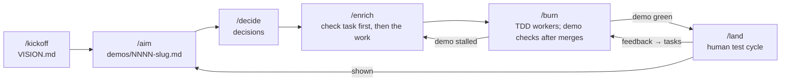

# Trajectory Workflow

A demo-driven, proof-driven build workflow. The human checkpoints are **demos** — points where something can really be shown working, each with a scenario and an executable end-to-end check that turns the demo green only when the code actually runs it. Tasks flow through one flat dependency graph at whatever speed the agents manage; they *list* the demos they serve as a scheduling hint, but nothing is grouped, and nothing waits for a group. Every risky assumption a demo stands on becomes a decision with an explicit **proof obligation**. Scripted helpers do all the mechanical bookkeeping; subagents carry the heavy work off the main thread.

## The story



| Step | Produces |
|------|----------|
| `/kickoff` (once, re-entrant) | Socratic vision + vocabulary → `VISION.md` |
| `/aim` | idea → next demo (outcome, scenario, human check, open decisions, proof items) → `demos/NNNN-slug.md` |
| `/decide` | settle the demo's open calls → `documentation/decisions/NNNN-slug.md` |
| `/enrich` | demo → well-shaped tasks, the demo's executable check first → `tasks/NNNN-slug.md` |
| `/burn` | parallel TDD workers burn the available set down; demo checks run after merges |
| `/land` | the human test cycle on a green demo: walk-through, feedback → tasks, proofs, `shown` |

`/supplement` captures small tasks that serve no demo (bugs, chores, improvements) with the same rigor as `/enrich`; `/decide` is also invoked out-of-band whenever a decision is made, challenged, or contradicted; `/example` pins a scenario's input or surface down in bytes (usually offered by `/aim`).

## Demos, not milestones

Milestones used to do two jobs at once: group tasks, and mark the points where a human can test something real. The grouping does not survive coding agents — a backlog burns down in hours, unattended, and "all tasks of the group done" turned out to be a poor stand-in for "the outcome works" (the classic failure: every task landed, the server still did not serve). So the checkpoint stays and the grouping goes:

- **A demo is a checkpoint.** `## Scenario` (numbered steps through the real entry point, each with the observation that proves it), `## Human check` (what only a person can judge), and a `check:` command that automates the scenario end to end.
- **The code decides.** A demo's `red`/`green` status is written only by `backlog.sh demo-check`, which runs the check; `/burn` runs it after every merge of a task that lists the demo, and over all open demos at the end of a run. Nobody can set a demo green by hand.
- **Outside-in.** `/enrich` mints the demo's check as the first task, so every demo starts red by construction and turns green when — and only when — the outcome runs.
- **Stalled = the gap signal.** A red demo that no live task lists is STALLED: everything known landed and it still fails, so the missing work was never written down. The board warns, and `/enrich <demo>` reads the failing check's log and mints the missing tasks. No up-front coverage bookkeeping is needed — the running check finds the uncovered ground.
- **Gates.** `gate: flag` (default) queues a green demo for the human while burning continues; `gate: hold` stops an unattended run at it, for when the next work depends on the human's verdict — and keeps holding until it is shown (a later `/burn` asks before building past an unseen hold demo).
- **Verdicts gate breakdown, not scheduling.** When a demo builds on a direction the human hasn't seen yet, the open judgment is a decision item marked with the demo it waits on (`— after: NNNN`). `/decide` won't take it before demo NNNN is shown, so `/enrich` won't break the waiting demo down; the board shows it as **WAITING**, not stalled. `/land NNNN` offers to decide those items while the verdict is fresh. Nothing is grouped — only work that can't yet be shaped waits.
- **Unattended goal.** `/burn demo:<id>` burns only what that demo needs and stops when it can be shown.
- **Showing never reopens done work.** `/land` turns test-cycle feedback into new tasks — fix-before-showing ones list the demo (and extend its check when an expectation changed, turning it red again), follow-ups go elsewhere.

Demo lifecycle: `red` → `green` → `shown` (accepted at `/land`); `dropped` is the human tombstone.

## Examples: the spec in bytes

A scenario step that says "run a workflow definition" leaves the most important question open: what does the definition look like? An **example** answers it in bytes — a sample definition, config, payload, or a CLI **transcript** (`$ command` blocks with expected output and exit codes). `/example` puts a fully filled-in strawman on the table (people react to bytes far better than to a blank page), and every invented value is then settled with the user: *agreed* (local to the artifact), *decided* (it commits more than the example — routed to `/decide`, back-referenced), or *left open* (incidental: names, hashes, timestamps). The record (`documentation/examples/NNNN-slug.md`) carries `## Pinned facts` — the consumption surface tasks and graders read instead of the bytes — and `## Open values`; the bytes live beside it in `documentation/examples/NNNN-slug/`.

- **Binding comes from a demo, and the code decides.** A demo lists the examples its scenario drives (`examples: [...]`), and its check reads the artifact **in place** — never a copy — so the example binds exactly as far as running code is checked against it. The board shows a settled example as **demonstrated** once a demo listing it is green.
- **Draft examples gate breakdown.** `set-status example … settled` refuses while an open value is unticked, and a draft example listed by a red demo is an open item: `/enrich` will not break the demo down on bytes nobody agreed to.
- **Changing one is a scenario change.** Examples are read-only for the whole `/burn` crew (the grader rejects a diff touching them, or a check that copies them). Revision goes through `/example`, with the user; the next `demo-check` re-tests the code against the new bytes, and a demo it turns red with nothing left to fix it shows up STALLED — the existing gap signal mints the work.

## The proving loop (the signature move)

`/aim` writes "what needs to be proven" into the demo → `/decide` turns each item into a decision with `status: accepted, proof: pending`, back-referenced from the demo item, and decomposes it into a **`## Proof` claim list** (one checklist line per thing running code must demonstrate) → `/enrich` attaches the decision id to the `proves` list of the task(s) that will demonstrate it, wiring per claim and naming any claim no task covers → `/land` walks the claims one at a time against the closing records and the green demo check, ticks each on its evidence, and consults the user before flipping the decision to `proof: proven`. Contradicting evidence is never silently edited over — `/land` routes it to `/decide` for revision or supersession. A pending proof with no live proving task is a standing board warning. Proofs never block a demo from being shown; an open claim simply stays visible.

**Records are evidence, so records are verified.** The closing records `/land` composes the walk-through from have a quiet, durable failure mode: a worker composes a plausible walk-through from the code it just wrote, the quoted output was never what shipped, and nothing downstream re-derives it. So the record is observed at every point it is touched: `burn-worker` runs each step it writes (failure paths included) and pastes real output, marking `[unverified]` what it could not run; `grader` traces every command and quoted literal to the shipped code and rejects an unsupported one even when every criterion is met; `burn-scribe` transcribes output as bytes with markers intact; `doc-syncer` runs a command before writing what it prints; `/land` re-runs the demo check at HEAD and re-verifies the records it hands to the user. An `[unverified]` step is an expectation, never evidence. The demo check is the one piece of evidence nobody composes.

Claims exist because one decision statement usually carries several — routinely demonstrated by different tasks through different surfaces (one through the library API, another only through the actual entry point). `set-proof … proven` therefore refuses while any claim is unticked.

## Skills

| Command | What it does |
|---------|-------------|
| `/kickoff` | Socratic interview → `VISION.md` with purpose, users, success, invariants, and a one-line-per-term `## Vocabulary` section (the referent `/enrich` checks every task against). Re-entrant (diff-oriented revision mode). Closes a first run by offering the foundational decisions (stack, persistence, testing) as a `/decide` batch — never smuggled into the vision |
| `/aim` | Idea (or own proposal when empty) → scouted demo: outcome, a scenario of concrete steps through the real entry point with expected observations, the human-only checks, gate (`flag`/`hold`), decisions to make before breakdown, what needs proving. The aiming question is "what can I show next?". Delegates project recon to `aim-scout` |
| `/decide` | One decision, Socratically understood then persisted: record + `DECISIONS.md` index line; demo-spawned proofs get `proof: pending`, a back-reference, and a `## Proof` claim list decomposing the decision statement clause by clause. Argless it takes the next open item from the lowest-id red demo; given an existing id it revises or supersedes. Spawns `decision-summarizer` to rewrite the derived `documentation/<topic>.md` digests |
| `/enrich` | Demo → tasks, all shaping **before** persistence (tasks are never split after; ids stay live for life). The demo's executable **check task comes first** (outside-in: red until the outcome runs), its command recorded in the demo's `check:` field; then the work behind each scenario step: plan with files to touch, decision/doc refs, `demos`, complexity (`low\|medium\|high`), `depends_on`, acceptance criteria, `proves` links. Hard gate: unresolved decision or needs-proving items refuse breakdown → `/decide`. Also the entry point for a **stalled** demo (reads the failing check's log, rules out the environment, mints the missing work) and re-shapes `/burn`'s UNDERESTIMATED hand-backs (narrow the original in place, mint the remainder). Per-task `task-linker` scan; vocabulary check against `VISION.md` |
| `/example` | One concrete **example** — a sample definition/config/payload, or a CLI **transcript** — pinning a piece of the spec down in bytes: the `example-drafter` seeds a fully filled-in strawman (or annotates an artifact the user brings), every invented value is then settled with the user one at a time (*agreed* / *decided* via `/decide` / *left open*), and the result lands as `documentation/examples/NNNN-slug.md` (record: pinned facts, open values) + `documentation/examples/NNNN-slug/` (the bytes). `draft` → `settled` (refused while open values remain); demos list the examples their scenario drives, a draft one gates `/enrich`, and the demo check reads the bytes in place — so a settled example is the spec the code is checked against, shown as **demonstrated** once a demo listing it is green. Revising one a demo drives is a scenario change |
| `/supplement` | Small demo-less task (bug/improvement/chore) with the same rigor — including proposing a multi-task breakdown when the input is bigger than one well-shaped task. Also how `/land` captures test-cycle findings |
| `/burn` | `[<count>\|all\|demo:<id>][@<workers>]` burn-down over the available set (`todo`, deps done, ascending id; `demo:<id>` scopes to that demo's tasks and their dependencies and stops once it is green with no live task): per task, `burn-worker` (TDD in a worktree, commits via `/commit`, model tier from `complexity` — default `low=sonnet medium=opus high=opus`, overridable via `.workflow-overrides/model-map`) → `grader` (strict vs. acceptance criteria + linked decisions, the manual-testing record traced to the shipped code, and no weakened demo check) → serialized `burn-scribe` (closing record) → sequential `merger` (conflict = bounce to a fresh worker; post-merge red suite = escalate once, then break out) → serialized `doc-syncer` → **demo checks** for the demos the task lists. A demo turning green is queued for `/land` (`flag`) or stops the run (`hold`); a green demo turning red is surfaced as a regression. Wrap-up checks every open demo and leads with what is ready to show. Pointer-passing keeps the session lean. Resumable/idempotent |
| `/land` | The human test cycle on a green demo: re-run the check at HEAD, compose a verified walk-through (setup, scenario steps with expected observations, the human checks, caveats), let the user try it, turn feedback into tasks (fix-before-showing / follow-up / not a problem), clear proof claims with the user (contradictions routed to `/decide`), update docs, write the `## Showing` record, and flip the demo to `shown` (or leave it for another round, or drop it) |

## Asking the user

Every skill here is a dialog skill, and all of them may use `AskUserQuestion`. The split is deliberate and documented once in `skills/_shared/workflow-overview.md`: **closed, option-shaped** turns are posed as options — which candidate demo to aim at, which alternative a decision picks (with `preview` when the alternatives are concrete artifacts), fold-vs-re-scope on an overlap, a finding's disposition, approve/defer a pending proof, revise-vs-supersede, shown vs. not yet vs. drop, the few points `/burn` stops at mid-run — while **open discovery** (who the users are, why an assumption is risky, what the user found in a test cycle) stays in prose, because options there railroad the user toward the model's framing.

## Project artifacts

| Path | Content |
|------|---------|
| `VISION.md` | purpose, users, success, invariants, `## Vocabulary` |
| `demos/NNNN-slug.md` | outcome, scenario, human check, decisions to make, needs proving, showing record; frontmatter `status`, `gate`, `check`, `checked_at` |
| `tasks/NNNN-slug.md` | plan, acceptance criteria, closing record |
| `documentation/decisions/NNNN-slug.md` | full decision records (context/decision/rationale/consequences/proof claims) |
| `documentation/DECISIONS.md` | one-line-per-decision index |
| `documentation/<topic>.md` | derived per-topic digests — never authored by hand |
| `documentation/examples/NNNN-slug.md` | example record: what it pins, pinned facts, open values, left open; frontmatter `status`, `decisions`, `artifacts`, `source` |
| `documentation/examples/NNNN-slug/` | the example's artifact bytes, in their native format — read in place by demo checks |
| `.trajectory/demo-NNNN.log` | last `demo-check` output per demo — scratch, keep `.trajectory/` in `.gitignore` |

The `NNNN-` filename prefix is the canonical id and is never duplicated into frontmatter (two sources of truth drift, and YAML parses bare `0042` as octal). Frontmatter carries only the mechanical attributes (`status`, `gate`, `check`, `checked_at`, `examples`, `proof`, `complexity`, `demos`, `depends_on`, `decisions`, `proves`, `documents`, `superseded_by`, `artifacts`, `source`).

## Deterministic bookkeeping

Every mechanical question goes through `skills/_shared/scripts/backlog.sh` (`new`, `next-id`, `ready [--demo <id>]`, `by-status`, `by-demo`, `get`, `blockers`, `dependents`, `provers`, `set-status`, `set-proof`, `set-superseded`, `by-example`, `open-values`, `demo-check`, `demo-state`, `waiting-on`, `held`, `pending-proofs`, `proof-claims`, `check`, `board`, `dense`) — no skill or subagent ever scans the backlog; prose bodies are read only by the one agent working that one item. `backlog.sh check` runs after every backlog write: canonical filenames, dangling references, demo field values, live deps on rejected tasks, dependency cycles, dangling example references, missing artifact files, and a settled example with open values fail hard; stalled demos, demos driving a draft or retired example, demos without a check, pending proofs with no live proving task, verdict items awaiting a dropped demo, and green hold demos not yet shown are warnings the board repeats; a verdict item awaiting a missing demo fails hard. `demo-check` runs each demo's check command from the project root and is the only way a demo turns green (`set-status demo … green` is refused, and `shown` requires `green`). `backlog.sh board` doubles as the user's board (`-c` colors the status column; a demo checked at an older commit is marked stale), and `backlog.sh dense` is its at-a-glance twin: one glyph per item with the slot position equal to the id, grouped in tens. Requires `yj` and `jq`.

`demo-check` executes project code with the session's permissions; under a sandbox, keep checks hermetic (ephemeral ports, temp dirs, local fixtures), and treat a red result caused by the environment as an environment problem, not missing work.

Task `rejected` is a human tombstone, never a grader verdict — and rejection **ripples**: the skill flipping it rewires every dependent edge in the same session, and re-homes or revisits any proof the task carried. Dropping a demo ripples to its live tasks the same way.

## Commits

The foreground skills (`/kickoff`, `/aim`, `/decide`, `/example`, `/enrich`, `/supplement`, `/land`) **never commit** — they write their backlog files, run `backlog.sh check`, name what they wrote, and leave the diff for the user to review and commit (`/commit`). Committing happens only inside `/burn`, which runs unattended: `burn-worker` commits its code via `/commit` (one commit per task, inside its worktree), `burn-scribe`/`merger`/`doc-syncer` commit the closing record, merge, and doc sync, and the orchestrator commits status flips and the demo files `demo-check` rewrites — each with an explicit pathspec (`git commit … -- <files>`), so bookkeeping can never sweep unrelated working-tree changes along.

## Subagents

Nine bundled agents in `trajectory/agents/`: four read-only proposers (`aim-scout` — project recon for `/aim`, including the entry points a scenario can drive and the examples it could drive; `example-drafter` — fully filled-in example strawman (or annotation of a provided artifact) with grounded/invented values split, for `/example`; `task-linker` — duplicate/link scan for `/enrich`/`/supplement`; `grader` — strict acceptance review, self-briefed from the task file, rejects a weakened demo check) and five write-side workers (`burn-worker` — one task, TDD in a worktree, self-briefed from pointers, runs the checks of the demos its task lists, full report parked at `.burn/REPORT.md`, commits via `/commit`, never touches backlog files or examples; `burn-scribe` — serialized closing-record writer, the one delegated backlog write; `merger` — sequential merge-back, bounce-on-conflict; `doc-syncer` — post-merge doc refresh, strictly serialized; `decision-summarizer` — rewrites the derived topic digests for `/decide`). The `/burn` orchestrator owns every task status write; `demo-check` owns every demo red/green.

Depends on **`common`** being installed alongside it for `/commit` (the single code-commit point).

## Migrating a milestone project

Projects started on the milestone version keep their `tasks/` and decisions. To move over: rename `milestones/` to `demos/`, and per milestone rewrite the body to `## Outcome` / `## Scenario` / `## Human check` / `## Decisions to make` / `## Needs proving` / `## Showing` (the old `## Breakdown` map can go — the check replaces it; the old `## Landing` becomes `## Showing`), set the frontmatter to `status: red` (or `shown` for a landed one), `gate: flag`, `check: ""`, `checked_at: null`, and rename `milestones:` to `demos:` in every task's frontmatter. Then `backlog.sh check` lists every open demo as lacking a check — `/enrich <id>` mints them.

## Installation

```bash
./install.sh trajectory                  # global
./install.sh trajectory /path/to/project # per-project
```
